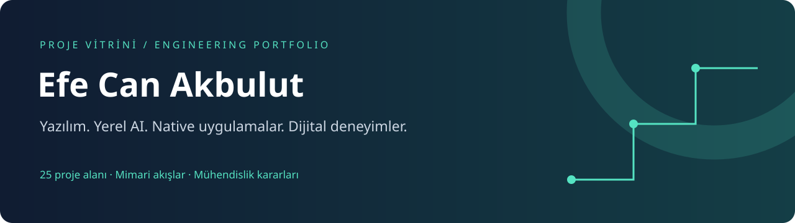

# Projeler ve mühendislik

Yerel yapay zekâ araçları, native Apple uygulamaları, veri platformları, web ürünleri ve marka deneyimleri. Her proje sayfası ürünün ne yaptığını, teknik katmanlarını ve mühendislik sınırlarını anlatır.

**25 proje alanı · 7 kategori · 4 mimari şema**

Bu katalog kamuya açık tanıtım belgelerini içerir. Uygulamaların kaynak kodları, geliştirme geçmişleri, kullanıcı verileri ve çalıştırılabilir paketleri burada yer almaz. Başlangıç projeleri ve yer tutucular kendi kategorisinde açıkça belirtilmiştir.

## Öne çıkan çalışmalar

| Proje | Odak | İncele |
| --- | --- | --- |
| **Bigital AI Factory** | AI çalışanları, görev grafiği, izole yürütme ve insan onayı | [Mimari →](projects/bigital-ai-operations-platform/) |
| **Bigital Prospect AI** | Kaynak kanıtlı B2B araştırma ve CRM | [Mimari →](projects/bigital-prospect-ai/) |
| **Kıbrıs Emlak Intelligence** | Zamana bağlı ilan verisi ve native analiz | [Mimari →](projects/kibris-emlak-intelligence/) |
| **ClarityFlow AI** | Yerel fotoğraf işleme ve doğrulanan çıktılar | [Mimari →](projects/clarityflow-ai/) |

## Proje kataloğu

### AI ve operasyon

| Proje | Ürün ve teknik odak |
| --- | --- |
| [Bigital AI Factory](projects/bigital-ai-operations-platform/) | İşletme ve proje bağlamında AI çalışanlarını, görev grafiğini ve kalite kontrollerini koordine eden yerel operasyon sistemi. Node.js · pnpm · SQLite · CLI/OAuth/API adaptörleri |
| [Bigital Prospect AI](projects/bigital-prospect-ai/) | Yerel işletme keşfi, kaynak kanıtları ve hafif CRM iş akışını birleştiren, Türkçe öncelikli B2B araştırma çalışma alanı. Next.js · TypeScript · FastAPI · SQLAlchemy · PostgreSQL · Redis · Ollama |
| [SociAI](projects/sociai-social-media-operations/) | Ajans ve müşteri kapsamlarında içerik taslaklarını, yayın takvimini ve mesajlaşmayı yöneten sosyal medya operasyon MVP’si. Node.js · SQLite · Docker · Meta WhatsApp Cloud API · SSE |

### Veri ve gayrimenkul

| Proje | Ürün ve teknik odak |
| --- | --- |
| [Kıbrıs Emlak Intelligence](projects/kibris-emlak-intelligence/) | Gayrimenkul ilanlarını zaman içinde izleyen; fiyat, durum ve veri kalitesi değişimlerini analiz eden yerel masaüstü platformu. SwiftUI · Swift Charts · FastAPI · Pydantic · SQLAlchemy · SQLite/PostgreSQL · Ollama |
| [Insula Prime](projects/insula-prime-real-estate-crm/) | Gayrimenkul vitrini ile personel ve yönetim iş akışlarını aynı PHP tabanlı projede birleştiren platform. PHP · MySQL · ortak layout ve veri yardımcıları |

### Native uygulamalar

| Proje | Ürün ve teknik odak |
| --- | --- |
| [ClarityFlow AI](projects/clarityflow-ai/) | Gayrimenkul ve mekân fotoğraflarını macOS üzerinde tek tek ve toplu olarak iyileştiren yerel fotoğraf işleme uygulaması. SwiftUI · Core Image · ImageMagick/AutoTone · Lensfun · NAFNet MLX · Upscayl |
| [MacSpace](projects/macspace-macos-maintenance-suite/) | Sistem bakımını, uygulama incelemesini ve içerikten dosya düzenleme önerilerini Türkçe bir macOS arayüzünde birleştiren MVP. Swift 6 · SwiftUI · Swift Package Manager · isteğe bağlı Apple Intelligence |
| [Scarlight](projects/scarlight-ios-card-game/) | Tur ve faz durumlarını görünür tutan, yerel çalışan SwiftUI iOS kart oyunu. SwiftUI · MVVM · yerel veri saklama · Xcode |
| [Biveyos Interview Console](projects/biveyos-interview-console/) | Aday havuzu ve mülakat ekranlarını masaüstü çalışma alanında birleştiren Python uygulaması. Python · Tkinter/CustomTkinter · JSON · PDF ve ses işleme modülleri |
| [WebP Converter](projects/webp-image-converter/) | Görselleri kalite ve boyut seçenekleriyle toplu olarak WebP biçimine dönüştüren Python masaüstü aracı. Python · Pillow · masaüstü UI |
| [Dinamik QR Kod Yöneticisi](projects/dynamic-qr-code-manager/) | Hedef URL’leri düzenlenebilir kısa kodlarla eşleştiren, QR görselleri üreten yerel masaüstü uygulaması. Python · Tkinter/ttk · SQLite · qrcode · Pillow · http.server |

### Otomasyon araçları

| Proje | Ürün ve teknik odak |
| --- | --- |
| [Kontrollü DOM Analiz Uygulaması](projects/controlled-dom-analyzer/) | Açık tarayıcı penceresindeki görünür liste içeriklerini inceleyen, filtreleyen ve kontrollü işlemler sunan masaüstü uygulaması. Python · Tk/Tcl · masaüstü tarayıcı otomasyonu · CSV |
| [WhatsApp Lead Bot](projects/whatsapp-lead-routing-bot/) | Aynı gönderenden gelen mesajları zaman penceresinde birleştirip özet lead kaydını seçilen gruba ileten yerel otomasyon. Node.js · whatsapp-web.js · yerel dashboard |

### Web ürünleri

| Proje | Ürün ve teknik odak |
| --- | --- |
| [Insightful Meetings / Biveyos](projects/insightful-meetings-biveyos/) | Toplantı ve mülakat kayıtları, transkriptler, analizler ve raporlar etrafında kurulan React web uygulaması. React 18 · TypeScript · Vite · Tailwind · Radix/shadcn · Supabase |
| [Efe Can Akbulut — Portfolyo](projects/efe-can-akbulut-portfolio/) | Proje ve içerik sunumunu React arayüzü ile PHP/MySQL CMS katmanında birleştiren kişisel portfolyo. React 19 · TypeScript · Vite · PHP 8 · PDO · MySQL |
| [Adatekno — Mağaza ve Yönetim](projects/nart-falcon-store-admin/) | Türkçe ürün kataloğu, varyantlı sepet ve veri tabanına bağlı yönetim işlemlerini birleştiren mağaza projesi. Next.js/Node.js · SQLite · alternatif PHP çalışma zamanı |
| [Nart Falcon Platform](projects/nart-falcon-ecommerce-platform/) | Kurumsal site ile ürün yönetimi ve WhatsApp sipariş talebini ayrı yayın hedeflerinde birleştiren monorepo. HTML/CSS/JavaScript · React · TypeScript · Vite · PHP · MySQL |
| [NART FALCON Ticaret — Arayüz](projects/nart-falcon-storefront/) | Katalog, kategori ve ürün detay ekranlarına odaklanan React mağaza arayüzü projesi. React 19 · TypeScript · Vite · Tailwind CSS 4 |

### Marka ve içerik

| Proje | Ürün ve teknik odak |
| --- | --- |
| [NART FALCON — Kurumsal Site](projects/nart-falcon-corporate-site/) | Hizmetleri, yaratıcı alanları, içerikleri ve iletişim akışını koyu zemin ve lime marka vurgusuyla sunan kurumsal web projesi. HTML · CSS · JavaScript · PHP 8.1+ · Apache/cPanel |
| [NeoLife](projects/NeoLife/) | Gayrimenkul projeleri, hizmetler ve editoryal içerikleri Türkçe sunan çok sayfalı, responsive marka sitesi. HTML · CSS · JavaScript · Bootstrap · Swiper · GSAP · Node.js yayın araçları |
| [Aura In Cyprus](projects/aura-in-cyprus/) | Gayrimenkul, bölge rehberleri ve iletişim içeriklerini Türkçe sunan, mevcut tema üzerine marka katmanı eklenmiş web sitesi. HTML · CSS · JavaScript · PHP |
| [Türkçe MVP Demo Seçkisi](projects/turkce-mvp-demo-seckisi/) | On restoran ve kafe tasarımını tek katalogda toplayan; QR menü, ürün ve rezervasyon deneyimlerini örnekleyen demo seçkisi. Statik HTML/CSS/JavaScript · localStorage · sessionStorage |

### Başlangıç ve deneyler

| Proje | Ürün ve teknik odak |
| --- | --- |
| [Hype Script](projects/hype-script-vue-app/) | Vue ve Vuetify tabanlı uygulamalar için bileşen, durum ve gezinme altyapısı içeren başlangıç projesi. Vue 3 · TypeScript · Vite · Vuetify · Pinia · Vue Router |
| [Redstone Island Web](projects/redstone-island-web-scaffold/) | IDE yapılandırması aşamasındaki proje alanı; uygulama kaynağı henüz tanımlanmamıştır. Henüz tanımlı değil |
| [Test Placeholder](projects/test-placeholder/) | Deneme amacıyla ayrılmış, yalnızca README içeren yer tutucu depo. Henüz tanımlı değil |

## Projelerde görülen mühendislik yaklaşımı

- **Veri izi:** Araştırma kanıtı, kaynak bağlantısı ve değişim geçmişi; AI yorumundan ayrı ele alınır.
- **Katmanlar:** Arayüz, API, kalıcı veri ve harici servis adaptörleri kendi sorumluluklarında düzenlenir.
- **Yerel işleme:** Uygun projelerde fotoğraf, dosya ve model işlemleri kullanıcının cihazında yürütülür.
- **Hata görünürlüğü:** Eksik bağlantı, kısmi sonuç ve başarısız iş, başarılı teslimat gibi gösterilmez.
- **Kapsam açıklığı:** Demo davranışı, başlangıç iskeleti ve harici servise bağlı özellikler proje sayfasında belirtilir.

Bu ilkeler her proje için aynı olgunluk düzeyi veya aynı özellik seti iddiası değildir; ilgili sayfanın kapsam notları belirleyicidir.

## Bu vitrin nasıl okunmalı?

Teknik özetler mevcut proje README belgelerinden hazırlanmıştır. Bu katalog için yeni uygulama testleri veya canlı ortam kabulü yapılmamıştır. Bir özelliğin belgelenmesi, üretimde doğrulandığı anlamına gelmez. Üçüncü taraf tema, kitaplık, model ve türetilmiş bileşenler kendi lisans koşullarına tabidir.

**Güncelleme:** 4 Kasım 2026 · [GitHub profili](https://github.com/Rlosener)
