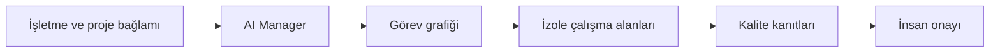

# Bigital AI Factory

**AI ve operasyon** · Proje incelemesi

İşletme ve proje bağlamında AI çalışanlarını, görev grafiğini ve kalite kontrollerini koordine eden yerel operasyon sistemi.

## Teknoloji

Node.js · pnpm · SQLite · CLI/OAuth/API adaptörleri

## Mimari akış

Talep → görev grafiği → izole çalışma alanı → kalite kontrolü → insan onayı

## Mühendislik odağı

- Manager, yürütme motoru, kapasite yöneticisi ve kalite katmanı ayrı sorumluluklar taşır.
- İşletme ve proje bilgisi ile genelleştirilmiş teknik deneyim farklı veri kapsamlarında tutulur.
- Git worktree izolasyonu ve komut kanıtları, görev teslimini izlenebilir hale getirir.

## Kapsam ve sınırlar

Sağlayıcı hesabı, kota ve canlı bağlantılar çalışma ortamında ayrıca doğrulanır.

Teknik özet mevcut proje dokümantasyonundan hazırlanmıştır. Bu vitrin kapsamında uygulama çalıştırma veya canlı ortam kabulü yapılmamıştır.

---

[← Proje kataloğu](../../README.md)

Bu sayfa tanıtım içindir. Uygulama kaynakları ve geliştirme geçmişi bu vitrinde dağıtılmaz.
