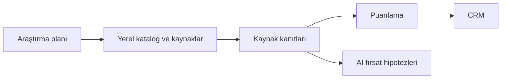

# Bigital Prospect AI

**AI ve operasyon** · Proje incelemesi

Yerel işletme keşfi, kaynak kanıtları ve hafif CRM iş akışını birleştiren, Türkçe öncelikli B2B araştırma çalışma alanı.

## Teknoloji

Next.js · TypeScript · FastAPI · SQLAlchemy · PostgreSQL · Redis · Ollama

## Mimari akış

Araştırma planı → yerel katalog / izinli kaynaklar → kanıt → puanlama → CRM

## Mühendislik odağı

- Kaynak URL’leri ve kanıtlar, AI tarafından üretilen fırsat hipotezlerinden ayrı saklanır.
- Araştırma işleri worker lease ve heartbeat ile izlenir; kesilen işler yeniden ele alınabilir.
- Workspace rolleri, mükerrer kayıt kontrolü ve dışa aktarma araştırmadan CRM’e geçişi destekler.

## Kapsam ve sınırlar

Yerel katalog tüm işletmeleri kapsama garantisi vermez; AI çıktıları doğrulanmış gerçek yerine hipotez olarak sunulur.

Teknik özet mevcut proje dokümantasyonundan hazırlanmıştır. Bu vitrin kapsamında uygulama çalıştırma veya canlı ortam kabulü yapılmamıştır.

---

[← Proje kataloğu](../../README.md)

Bu sayfa tanıtım içindir. Uygulama kaynakları ve geliştirme geçmişi bu vitrinde dağıtılmaz.
