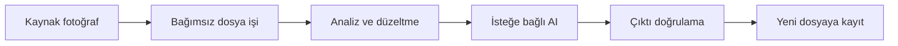

# ClarityFlow AI

**Native uygulamalar** · Proje incelemesi

Gayrimenkul ve mekân fotoğraflarını macOS üzerinde tek tek ve toplu olarak iyileştiren yerel fotoğraf işleme uygulaması.

## Teknoloji

SwiftUI · Core Image · ImageMagick/AutoTone · Lensfun · NAFNet MLX · Upscayl

## Mimari akış

Görsel kuyruğu → analiz → düzeltme → isteğe bağlı AI → çıktı doğrulama → dışa aktarma

## Mühendislik odağı

- Her dosya bağımsız işlenir; tek görselin hatası bütün kuyruğu durdurmaz.
- Kaynaklar korunur; çıktı adlarında çakışma yönetimi ve dosya doğrulama uygulanır.
- Motor uygunluğu ve kalite kontrolleri işlem yolunu belirler; AI çözünürlük artırma varsayılan olarak kapalıdır.

## Kapsam ve sınırlar

AI yeni doku tahmin edebilir. İsteğe bağlı motorlar cihaz ve üçüncü taraf lisans koşullarına bağlıdır.

Teknik özet mevcut proje dokümantasyonundan hazırlanmıştır. Bu vitrin kapsamında uygulama çalıştırma veya canlı ortam kabulü yapılmamıştır.

---

[← Proje kataloğu](../../README.md)

Bu sayfa tanıtım içindir. Uygulama kaynakları ve geliştirme geçmişi bu vitrinde dağıtılmaz.
